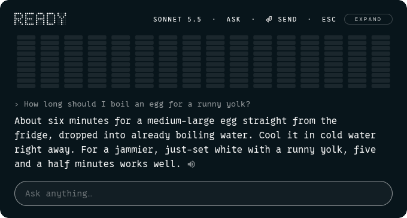
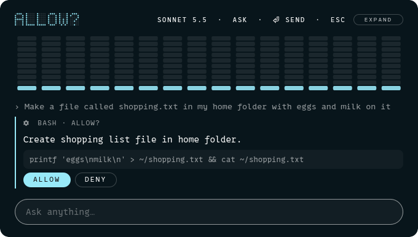
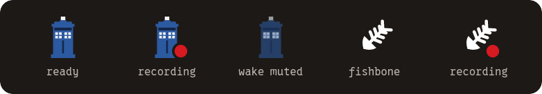

# Fishsticks & Custard

A voice assistant for your Hyprland desktop. Say *"fishsticks and custard"*, press a key or
click the police box in your tray, then ask it something. It answers in a small popup and,
if you spoke, reads the reply aloud.

<p align="center"></p>

- **Talk or type.** Use the wake phrase, hold a key to talk, or type into the popup.
- **Uses the AI subscription you already have.** It works with Claude (through Claude
  Code), ChatGPT (through Codex), Google (through Antigravity), or OpenCode's free models.
  Nothing extra to pay for.
- **Asks before it acts.** Before running a command, writing a file or fetching a page, it
  shows you exactly what it wants to do and waits for you to answer.
- **Your voice stays on your computer.** Speech recognition and the spoken voice run
  locally. Only the text of what you ask goes to the agent.
- **Remembers what matters.** It keeps a short list of facts about you between
  conversations. It's a plain file you can read, edit or delete.
- **Speaks 18 languages**, with a choice of voices for each.

## Contents

- [What you need](#what-you-need)
- [Install](#install)
- [Getting started](#getting-started)
- [When it asks first](#when-it-asks-first)
- [The tray icon](#the-tray-icon)
- [Keys and commands](#keys-and-commands)
- [Choosing an agent](#choosing-an-agent)
- [Languages and voices](#languages-and-voices)
- [The wake phrase](#the-wake-phrase)
- [Conversations and memory](#conversations-and-memory)
- [Bluetooth headsets](#bluetooth-headsets)
- [Privacy](#privacy)
- [Settings](#settings)
- [Troubleshooting](#troubleshooting)
- [Updating and uninstalling](#updating-and-uninstalling)

## What you need

- **Arch Linux with Hyprland.** Other Wayland compositors may work, but it's made for
  Hyprland. It doesn't run on X11.
- **A system tray** for the icon, such as Waybar's `tray` module.
- **An account with one of the agents** (see [Choosing an agent](#choosing-an-agent)).
  Claude Code is the default. OpenCode needs no account at all.
- **For voice:** a microphone, and speakers or headphones. Typing works without either.
- **About 700 MB of disk** for the speech models. A graphics card with Vulkan drivers
  makes speech recognition fast. It also runs on the CPU, more slowly.

## Install

1. **Trust the package signing key:**

   ```sh
   curl -sL https://raw.githubusercontent.com/ManofJELLO/fishsticks-and-custard/main/packaging/arch/fishsticks-and-custard.asc \
     | sudo pacman-key --add -
   sudo pacman-key --lsign-key 3286286EB33C3D8E9B47D6EF0A83688698B6FA30
   ```

2. **Add the repository** to the end of `/etc/pacman.conf`:

   ```ini
   [fishsticks-and-custard]
   Server = https://github.com/ManofJELLO/fishsticks-and-custard/releases/download/repo
   ```

3. **Install it:**

   ```sh
   sudo pacman -Syu fishsticks-and-custard
   ```

4. **Install an agent and sign in.** For Claude, install the
   [Claude Code](https://claude.com/claude-code) CLI and run `claude` once to sign in. For
   the others, see [Choosing an agent](#choosing-an-agent).

5. **Download the speech models** (about 640 MB, including a voice for your desktop's
   language), then check them:

   ```sh
   fsc fetch-models
   fscd --self-test
   ```

   The self-test speaks a sentence out loud and transcribes it back, so turn your
   volume up.

6. **Add the Hyprland lines.** Copy the contents of
   `/usr/share/fishsticks-and-custard/hyprland/fsc.lua` into `~/.config/hypr/hyprland.lua`.
   They set up the following:
   - the popup floats near the top of the screen on every workspace;
   - **Super+A** opens it for typing;
   - holding **Super+Shift+A** lets you talk.

   To start the assistant when you log in, add `hl.exec_cmd("fscd")` inside your
   existing `hl.on("hyprland.start", ...)` block.

7. **Start it.** Run `fscd`, or open **Fishsticks & Custard** from your app launcher. The
   police box appears in your tray.

## Getting started

**Type a question:** press **Super+A** (or click the tray icon), type, and press
**Enter**. Press **Esc** to hide the popup again.

**Ask out loud:** hold **Super+Shift+A**, speak, and let go. Or tap it once and just
talk: it stops listening when you stop talking.

**Use the wake phrase:** say *"Fishsticks and custard"*, then your question. You can say
both in one breath: *"Fishsticks and custard, how long do I boil an egg?"*

**Keep talking:** after a spoken reply it listens again, like a phone call, so you can
follow up without the wake phrase. While the status says **LISTENING** in red,
everything it hears goes to the agent. Press **Esc** to hang up. It also hangs up
after a minute of silence.

**Interrupt it:** say the wake phrase while it's thinking or talking (*"Fishsticks and
custard, actually…"*), or press the talk key. **Ctrl+C** in the popup stops a reply.

**Start over:** **Ctrl+N** starts a new conversation.

## When it asks first

<p align="center"></p>

Before the agent does something on your computer (runs a command, writes a file, opens a
web page), the reply pauses and the status turns to **ALLOW?** A card shows what it
wants to do and the exact command, address or file. You can answer in four ways:

- **ALLOW** lets it do this once.
- **ALWAYS** lets it do this kind of thing from now on without asking. It only appears
  when the agent offers it.
- **DENY** refuses. Closing the popup also counts as no.
- **By voice:** if you asked out loud, it also asks out loud (*"May I search the web
  for…? Yes, always, or no?"*). Answer *yes*, *always* or *no*.

Reading, searching and thinking don't need your permission.

## The tray icon

<p align="center"></p>

Click the icon to show or hide the popup. A red dot means the microphone is recording.
If you prefer, a fishbone icon is available as well (see [Settings](#settings)).
Right-click the icon for its menu:

| Menu item | What it does |
|---|---|
| **Type…** / **Talk** | Opens the popup for typing, or starts listening. |
| **Mute wake word** | Stops it listening for the wake phrase. The talk key still works. |
| **Microphone** | Chooses which microphone to use. |
| **Speak replies** | Chooses when replies are read aloud: when you talk (the default), always, or never. |
| **Language** / **Voice** | Chooses the language it speaks and listens in, and the voice it uses. |
| **Agent** | Chooses which agent answers. Agents that aren't installed are greyed out. |
| **Model** / **Mode** | Chooses the agent's model, and how much it asks before acting. |
| **New conversation** | Starts a new conversation. |
| **Forget memories** | Deletes what it remembers about you. |
| **Settings…** | Opens your settings (see [Settings](#settings)). |
| **Quit** | Closes the assistant. |

Changes made from the menu take effect straight away and are saved.

## Keys and commands

| Key | What it does |
|---|---|
| **Super+A** | Opens the popup for typing. |
| **Super+Shift+A** | Hold to talk, or tap to talk until you stop. |
| **Enter** | Sends your message. |
| **Esc** | Hides the popup, and hangs up a voice conversation. A reply still in progress finishes as text, and you get a notification. |
| **Ctrl+C** | Copies the text you highlighted in the popup. With nothing highlighted, stops the reply. |
| **Ctrl+Shift+C** | Copies the whole conversation in the popup, questions and replies, as plain text. |
| **Ctrl+N** | Starts a new conversation. |

The `fsc` command does the same from a terminal or a script. Run `fsc --help` for the
full list.

| Command | What it does |
|---|---|
| `fsc ask "…"` | Asks a question without opening the text field. |
| `fsc type` / `fsc listen` | Opens the popup for typing, or starts listening. |
| `fsc stop` / `fsc new` | Stops the reply, or starts a new conversation. |
| `fsc allow [--always]` / `fsc deny` | Answers a permission question. |
| `fsc status` | Prints what it's doing: `ready`, `listening`, `thinking`, and so on. |
| `fsc mute [on\|off]` | Mutes or unmutes the wake phrase. |
| `fsc wake [phrase]` | Shows the wake phrase, or changes it. |
| `fsc agent [name]` | Shows which agent answers, or switches to `claude`, `codex`, `antigravity` or `opencode`. |
| `fsc model [id]` / `fsc mode [id]` | Lists the agent's models or modes, or switches to one. |
| `fsc mic [name]` | Lists microphones, or switches to one (`default` for the system's). |
| `fsc speak [voice\|always\|never]` | Sets when replies are read aloud. |
| `fsc language [code]` / `fsc voice [name]` | Lists the languages or voices, or switches. |
| `fsc memory` / `fsc forget` | Shows what it remembers, or deletes it. |
| `fsc settings` | Opens your settings. |
| `fsc quit` | Closes the assistant. |

## Choosing an agent

The agent is the AI that answers. You can switch from the tray's **Agent** menu or with
`fsc agent codex`. The current conversation ends, and the new agent starts with the same
memory of you.

| Agent | Account | Install | Sign in |
|---|---|---|---|
| **Claude** (default) | Claude Pro or Max | [Claude Code](https://claude.com/claude-code) | run `claude` once |
| **Codex** | ChatGPT | the Codex CLI and `codex-acp` (AUR `codex-acp`, or `npm i -g @agentclientprotocol/codex-acp`) | `codex login` |
| **Antigravity** | Google | `agy` 1.5 or newer (AUR `antigravity-cli`) | `agy acp --login` |
| **OpenCode** | none for its free models | `sudo pacman -S opencode` | `opencode auth login`, only for your own providers |

If an agent isn't signed in, the popup tells you which command to run.

The tray's **Model** menu lists the agent's models. The **Mode** menu sets how much it
asks before acting. Claude's modes are Ask (the default), Accept edits, Auto and Plan.
Codex starts in read-only, which asks before any edit, command or network use. The
popup shows the current model and mode at the top.

Codex, Antigravity and OpenCode work in a folder of their own,
`~/.local/share/fsc/home/workspace`. They can write there freely, but they ask before
touching anything else of yours.

Any other agent that supports the [Agent Client Protocol](https://agentclientprotocol.com)
can be used too: set `backend = "acp"` and its `command` in the settings file.

## Languages and voices

It speaks and listens in English, German, French, Spanish, Italian, Portuguese, Dutch,
Polish, Swedish, Danish, Norwegian, Finnish, Czech, Russian, Ukrainian, Turkish, Hungarian
and Romanian. At first it uses your desktop's language, or English if that isn't on the
list.

Pick another language from the tray's **Language** menu, or with `fsc language de`. It
then listens for that language, speaks it, and tells the agent to reply in it.
Permission questions are asked in it too, and *yes*, *always* and *no* are understood in
that language as well as in English. The first time you pick a language, its voice
downloads (60 to 120 MB), and it says hello when it's ready.

The **Voice** menu lists every voice available for the language, with its download size.

The wake phrase doesn't change with the language. To use one in your own language, see
below.

## The wake phrase

While the assistant is running and the wake word isn't muted, it listens for the wake
phrase. This happens entirely on your computer, and nothing is sent anywhere until it
hears the phrase. Mute it from the tray or with `fsc mute`.

To change the phrase, run `fsc wake hey computer`. It takes effect straight away. The
phrase needs at least 5 letters and at most 5 words. Longer, unusual phrases are less
likely to wake it by accident. Short everyday ones can trigger in normal conversation,
and whatever is said after a false wake goes to the agent.

It only wakes when the phrase starts what you're saying. *"Okay, fishsticks and custard"*
works, but *"we had fish sticks and custard"* doesn't.

The wake phrase works best with a wired or USB microphone that's always connected. Choose
one from the tray's **Microphone** menu. If that microphone is unplugged, it waits for it
to come back rather than switching to another. The tray tooltip says when it's missing.

## Conversations and memory

A conversation lasts while you keep talking to it. After 20 minutes without a message, or
when you start a new one (**Ctrl+N**), it begins fresh. Earlier messages stay visible in
the popup above a **NEW SESSION** line.

Before a conversation ends, the agent updates a short list of lasting facts about you:
your preferences, the people and things you mention, plans you're working on, anything you
asked it to remember. It leaves out one-off questions and sensitive details. The list is
kept in `~/.local/share/fsc/home/memory.md`, a plain text file you can read and edit.

- `fsc memory` shows the list.
- `fsc forget` or **Forget memories** in the tray deletes it.
- To turn memory off, set `memory = false` in the `[agent]` section of the settings.

## Bluetooth headsets

Bluetooth earbuds and headsets have to switch into headset mode before their microphone
works, which takes a few seconds. While that happens, the popup shows **WAITING FOR
MIC…**. During a voice conversation, replies play at headset (call) quality.

To keep music and replies at full quality, use a separate microphone (a webcam or USB
mic) for listening: choose it in the tray's **Microphone** menu.

## Privacy

- **Your voice:** speech recognition and the spoken voice both run on your computer.
  No audio is sent anywhere.
- **The wake phrase:** it listens locally and sends nothing until it hears the phrase.
- **What is sent:** the text of your questions goes to the agent you chose, and through
  it to that company, just as if you typed it into that agent yourself.
- **Your memory file:** kept on your computer. You can read, edit or delete it.
- **Actions:** anything that changes your computer or reaches the web is asked about
  first, unless you've answered **ALWAYS** for it.

## Settings

The tray's **Settings…** opens [HyprCustard](https://github.com/ManofJELLO/hyprcustard) if
you have it installed, or your settings file, `~/.config/fsc/config.toml`, in your text
editor. If the file doesn't exist yet, it's created with every setting listed and
commented out. Changes to the file take effect when you restart the assistant
(`fsc quit`, then `fscd`).

Some settings you might want to change:

| Setting | What it does |
|---|---|
| `[ui] surface` | `"window"` (default) is a normal floating window. `"layer"` pins the popup to a screen edge or corner (`anchor`, `margin`). `"headless"` shows no popup: you talk to it, and questions and typed replies arrive as notifications. |
| `[ui] tray_icon` | `"police-box"` (default) or `"fishbone"`. |
| `[ui] visualiser` | `"spectrum"` (default) shows bars, `"loudness"` shows a level over time. |
| `[ui] accent` | The highlight colour. By default it follows your desktop. |
| `[ui] width`, `max_height` | The popup's size. |
| `[voice] end_silence_ms` | How long a pause ends what you're saying. Raise it if it cuts you off mid-thought. |
| `[voice] conversation` | Set it to `false` to stop listening again after each spoken reply. |
| `[voice] hang_up_after_secs` | Seconds of silence before a voice conversation hangs up. |
| `[voice] speech_rate` | How fast it talks. |
| `[agent] session_idle_minutes` | Minutes without a message before a new conversation starts. |

The full list, with explanations, is in
`/usr/share/fishsticks-and-custard/config.example.toml`.

The popup follows your GTK theme's colours and your desktop's light or dark mode.

**Personality:** how the assistant talks is described in
`~/.local/share/fsc/home/persona.md`. Edit it and press **Ctrl+N** to start a
conversation with the change.

**What Claude may do without asking:** your **ALWAYS** answers are saved in
`~/.local/share/fsc/home/.claude/settings.local.json`. Remove an entry from its `allow`
list to be asked again, or add one to `deny` to refuse it every time.

## Troubleshooting

- **No reply, or an error about signing in:** run the agent's sign-in command (see
  [Choosing an agent](#choosing-an-agent)). The popup names the command.
- **It doesn't hear you:** check the tray's **Microphone** menu, and that **Mute wake
  word** isn't ticked. Run `fscd --self-test` to check the speech models.
- **It cuts you off mid-sentence:** raise `end_silence_ms` in the `[voice]` settings.
- **It wakes up by accident:** choose a longer or more unusual phrase with `fsc wake`.
- **Nothing happens when you press Super+A:** check that the Hyprland lines are in your
  config, and that the assistant is running (`fsc status`).
- **To see what it's doing:** quit it (`fsc quit`) and start it in a terminal with
  `fscd`. Its messages appear there.

## Updating and uninstalling

Updates arrive with your normal `sudo pacman -Syu`. Afterwards, restart the assistant
with `fsc quit`, then `fscd`. If the update notes ask for new speech models, run
`fsc fetch-models`.

To uninstall, run `sudo pacman -Rns fishsticks-and-custard`. Your settings and data stay
in `~/.config/fsc` and `~/.local/share/fsc`. Delete those folders to remove them too.

---

To build from source, run `cd packaging/arch && makepkg -si`. For working on the code, see
[docs/DEVELOPING.md](docs/DEVELOPING.md).
